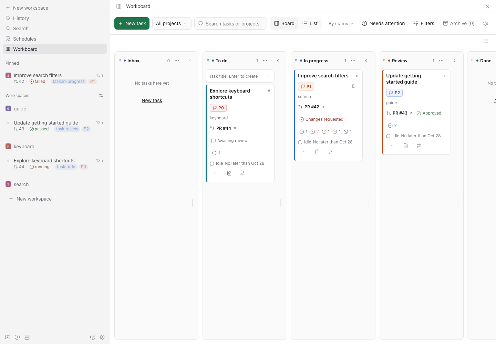
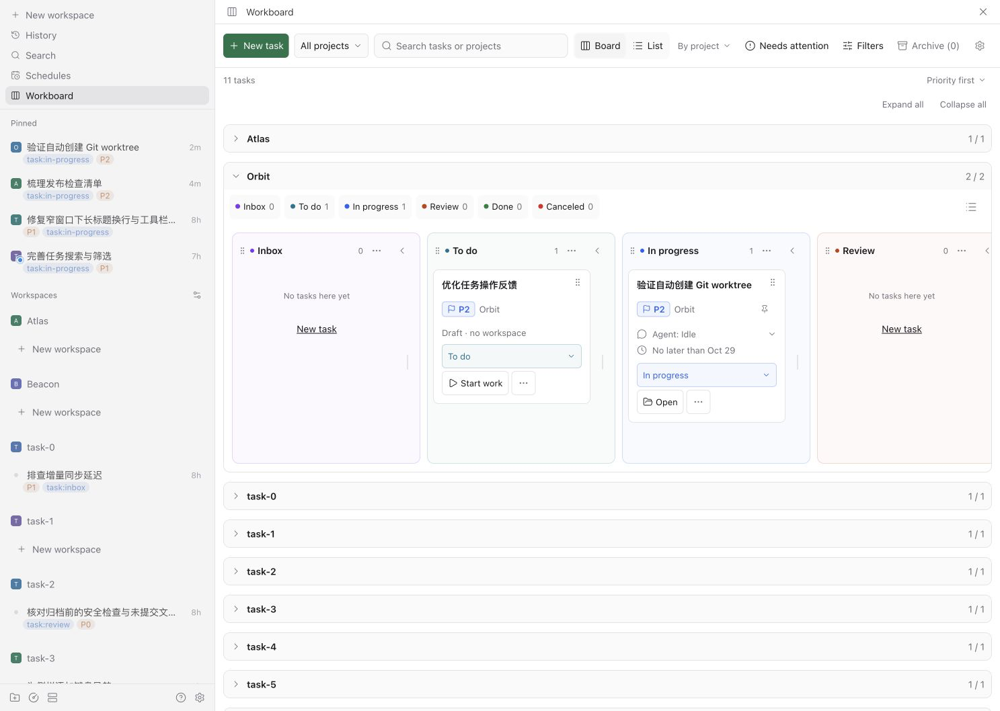
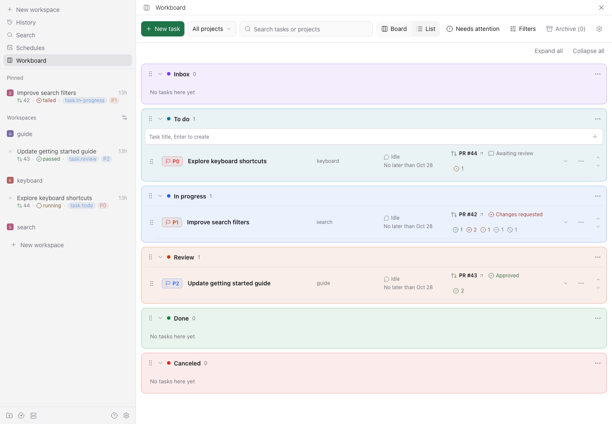
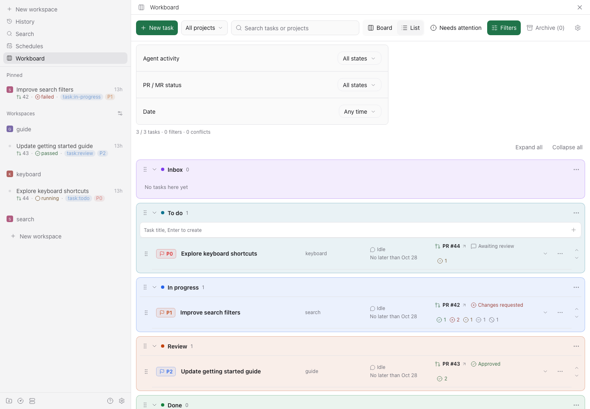
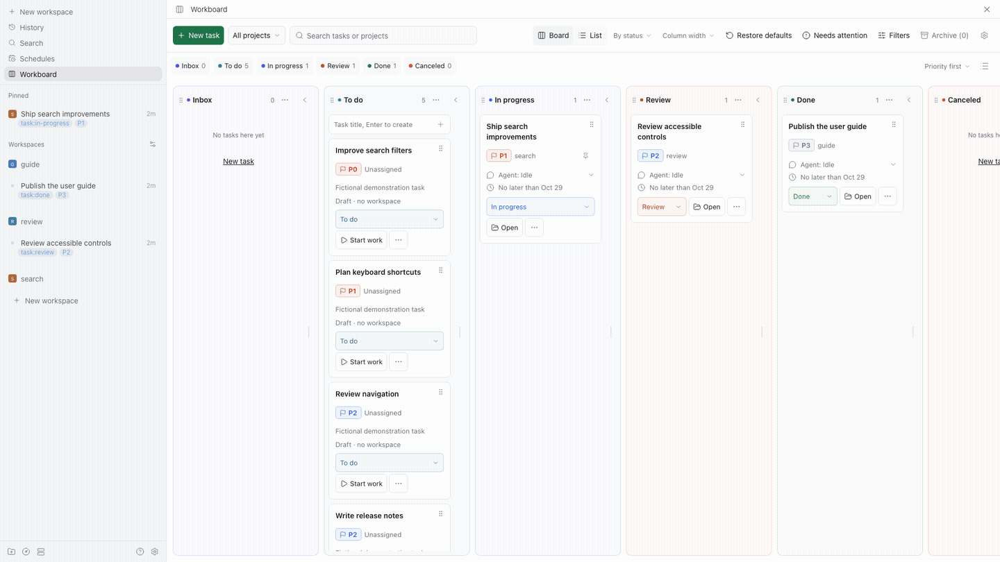
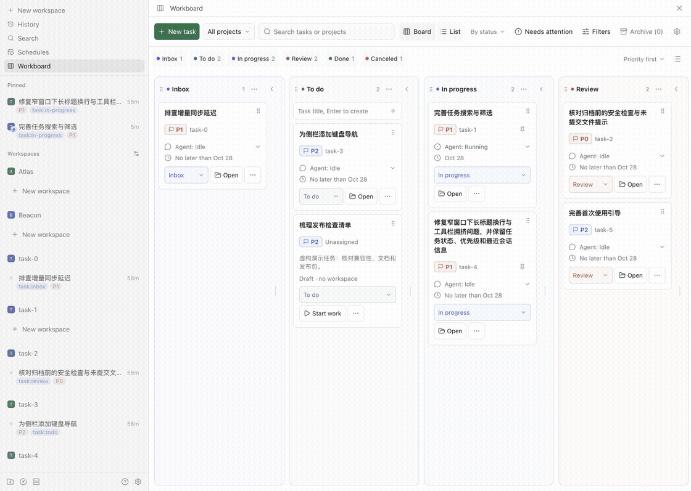

# Paseo Workboard

[简体中文](README.zh-CN.md)

A task board for [Paseo](https://paseo.sh) workspaces, from quick ideas to completed work.

Workboard brings active workspaces into one board, with one task per workspace. Capture an idea as a draft, create or attach a workspace when you start, and track progress in a board or grouped list. Task status stays under your control; an Agent finishing does **not** mark the task done.



## Features

- **Workspaces and drafts together.** Existing workspaces appear automatically. Drafts need only a title, with no workspace, directory, or Agent required.
- **Board and list views.** Both layouts share tasks, filters, and the saved default order, with separate collapsed groups. Priority sorting is enabled by default in both views; the toolbar sorting control or Settings can restore the saved default order. All status groups, including Done, Canceled and custom groups, use vertical columns. Cards expose status and Open or Start work actions directly.
- **Status linked to workspace labels.** Move a task between groups or change its managed label in Paseo. Both update the same status while preserving unrelated labels. Exclusive status labels, enabled by default for new installations, replace a previous managed label when a new one can be identified.
- **Activity at a glance.** See Agent activity, conversation dates, and PR/MR information supplied by Paseo, with CI status icons with counts and review text in both layouts, including compact lists. Filter by project, activity, PR/MR condition, attention, or last conversation date.
- **A configurable workflow.** Customize groups and their defaults, reorder tasks and groups by dragging or keyboard controls, and optionally pin in-progress workspaces in the sidebar.
- **Optional automatic archiving.** Configure Done and Canceled rules independently to archive eligible workspaces after their respective delays from their last verified conversation, with activity and Git safety checks. Disabled by default.
- **Project lanes and priorities.** Group the board by project, expand or collapse all visible project lanes, set task priorities, and switch between priority sorting and the saved default order. Customize priority names and colors in Settings. Priorities are P0–P3, with P0 highest and P2 as the unlabeled default. Native P0/P1/P2/P3 labels sync both ways and remain exclusive.

The interface follows Paseo's desktop/Web language and theme, with English and Chinese text and dates.

## See it in action

The board can show one collapsible lane per project, with priority controls on each card. [Learn about grouping and priorities](docs/user-guide.md#project-grouping-and-priorities).



The same tasks appear in the board and grouped list. Filters are shared; each view remembers its own collapsed groups.



The **Filters** panel includes last conversation date. Choose today, the last three calendar days, this week, or this month; tasks without a conversation date do not match a date range.





Move a task to another group to update its managed status label. The recent move can be undone from the toolbar while its brief undo window is open.



Group defaults, exclusive status labels, sidebar pinning, and optional automatic archive live in **Settings**.

See the [archive guide](docs/user-guide.md#archive-workspaces) for independent Done and Canceled switches, always-visible waiting-period controls, and due-task confirmation.

## Installation

Use Paseo 0.11.0 or later, as required by [paseo-plugin.json](paseo-plugin.json). Plugins run as trusted, unsandboxed code in the daemon; review the source before installing.

Install from the repository's default branch into the selected Paseo daemon:

```sh
paseo plugin install github:fxbing/paseo-workboard
```

This tracks the default branch, which may include changes newer than the latest [GitHub Release](https://github.com/fxbing/paseo-workboard/releases). Each Release marks a tagged snapshot with its upgrade notes; read them before upgrading. Enable plugins in Paseo, then open **Workboard** from the sidebar.

## Quick start

1. **Find your workspaces.** Active workspaces appear as tasks. With the default settings, workspaces without a managed status label enter **Inbox**; importing them does not write a label.
2. **Capture an idea.** Create a title-only draft. It starts in the configured draft group, **To do** by default, without creating a workspace or Agent.
3. **Start work.** Select a project: Git projects default to a Git worktree created and named by Paseo; non-Git projects use their project directory without path entry. You can change the creation method. A custom directory and attaching an existing workspace remain available. Start a conversation from the native workspace when needed; Workboard does not send a prompt for you.
4. **Track progress.** Move tasks between groups using the status menu or drag handle. Use **Settings** to adjust groups, defaults, sidebar pinning, and automatic archiving.

The [user guide](docs/user-guide.md) covers filters, ordering, undo, draft recovery, and settings.

## Documentation

| Guide                                                                 | Contents                                           |
| --------------------------------------------------------------------- | -------------------------------------------------- |
| [User guide](docs/user-guide.md)                                      | Task workflow, views, groups, and settings         |
| [Architecture](docs/architecture.md)                                  | Data ownership, synchronization, and safety checks |
| [Releasing](docs/releasing.md)                                        | Package validation, tagging, and Release procedure |
| [GitHub Releases](https://github.com/fxbing/paseo-workboard/releases) | Upgrade notes for every version                    |

## Contributing

**Open an issue before opening a pull request**, or join an existing issue covering the same change. Describe the problem or use case and the intended result first. Keep each PR focused and link its issue.

See [CONTRIBUTING.md](CONTRIBUTING.md) for issue and PR contents, local setup, and required checks. AI coding assistants must also follow [AGENTS.md](AGENTS.md); `CLAUDE.md` links to the same instructions.

For development, install Node.js (22.22.2 recommended, matching CI), npm, and Git.
See [the setup guide](CONTRIBUTING.md#setup-and-checks) for requirements; no runtime manager is required:

```sh
npm ci
npm run check
npm run format:check
```

Use the [isolated integration fixture](tests/integration/README.md) for host-level checks and local plugin evaluation.

## Limitations

- Some label and workspace operations use an internal Paseo bridge that reuses the host session and validates responses. The manifest minimum does not guarantee compatibility with every later Paseo release; read the upgrade notes in [GitHub Releases](https://github.com/fxbing/paseo-workboard/releases) before upgrading.
- Automatic archiving can stop Agents and terminals and may remove a managed worktree. Missing conversation evidence, incomplete child inventories, or unsafe state postpones it. Workboard cannot restore a native archive or a removed worktree. See the [archive guide](docs/user-guide.md#archive-workspaces) for the safety checks and recovery options.
- Labels, archive state, and sidebar pins can change outside Workboard. The host does not expose every atomic operation; uncertain outcomes require manual review instead of destructive retries.
- The supported clients are the Paseo Web and Electron desktop UI; native mobile is not a supported target. The automated UI smoke suite targets Chromium. Electron, long-duration edge autoscroll, and `Escape` or blur during an active drag remain unverified. Those interactions are implemented, including drag cancellation.

## License and acknowledgements

[MIT](LICENSE).

Inspired by [Paseo Thread Board](https://github.com/samgbafa/paseo-thread-board) and [Paseo Kanban](https://github.com/breathi3552/paseo-kanban).
