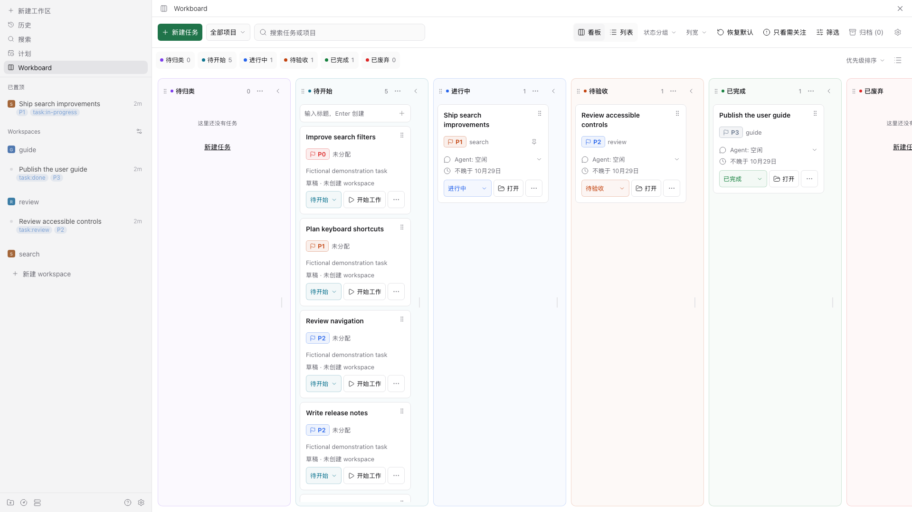

# Paseo Workboard

[English](README.md) · [使用指南](docs/zh-CN/user-guide.md) · [English user guide](docs/user-guide.md)

Workboard 是一个用于管理 Paseo workspace 与工作想法的插件，提供看板和分组列表两种视图。每个活跃 workspace 对应一个任务；也可以先记录只有标题的草稿，准备开始时再创建或关联 workspace。



## 关键能力

- 自动导入已有 workspace，每个 workspace 对应一个任务。
- 草稿不需要 workspace、目录、Agent 或会话。
- 分组与受管理的 workspace 标签共同表示任务状态；拖动卡片或修改原生标签都会更新同一状态。
- Agent 活动与任务状态分开显示。Agent 结束**不会**自动完成任务。
- 界面文案与日期跟随 Paseo 桌面端语言，支持中文和英语。
- 显示由 Paseo 提供的紧凑 PR/MR、CI 与评审结论信息。
- 可切换看板与分组列表；两者共享任务、分组与任务顺序和筛选，分别记忆折叠状态。看板另支持列宽和窄屏单分组布局。
- 分别设置新草稿、未标记 workspace 导入和开始工作的默认分组；开始工作默认组只选进行中类型。
- 拖动或使用键盘控件调整任务与分组顺序；列表纵向展示所有分组，包括空组与折叠后的投放目标，分组菜单可恢复活动排序。
- 可分别配置是否自动归档已完成和已废弃的 workspace，并为两者设置独立的等待期限。

## 兼容性与信任边界

最低 Paseo 版本由 `paseo-plugin.json` 声明。当前源码已在 Paseo 0.11.2 上完成隔离宿主集成验证；实际验证版本及客户端检查边界见[验证记录](docs/zh-CN/verification.md)。

公开插件 SDK 尚未覆盖 Workboard 所需的全部标签和 workspace 操作，因此插件使用复用宿主会话的内部桥接。manifest 设置最低版本，桥接在运行时校验响应；新的 Paseo 版本可能还需要适配。

插件服务端代码运行在 daemon 中。安装前请审阅源码，并将它视为受信任、未沙箱隔离的本地代码。

## 安装

从 GitHub 安装源码到当前选中的 Paseo daemon：

```sh
paseo plugin install github:fxbing/paseo-workboard
```

用于本地开发或评估时，可安装本地 checkout 到当前选中的 Paseo daemon：

```sh
npm ci
paseo plugin install /absolute/path/to/paseo-workboard
```

在 Paseo 中启用 Plugins 后，从侧边栏打开 **Workboard**。

## 快速开始

1. 打开 Workboard。已有的活跃 workspace 会显示为任务；没有受管理状态标签的 workspace 会进入**待归类**，导入时不会写入标签。
2. 有想法时创建只有标题的草稿。它位于**待开始**，此时没有 workspace。
3. 选择**开始工作**，创建 workspace 或关联已有 workspace；需要时再从原生 workspace 发起会话。
4. 按需切换视图，再用状态菜单或拖动把手将任务移到其它分组。受管理标签与任务状态保持同步。
5. 在**设置**中配置标签、分组、自动归档和可选的侧边栏置顶。

## 文档

- [使用指南](docs/zh-CN/user-guide.md)：任务流、分组、看板操作、归档、置顶和本地偏好。
- [English user guide](docs/user-guide.md)：英文版使用指南。
- [贡献指南](CONTRIBUTING.zh-CN.md) · [English contributing guide](CONTRIBUTING.md)
- [架构](docs/zh-CN/architecture.md) · [English architecture](docs/architecture.md)
- [发布](docs/zh-CN/releasing.md) · [English releasing guide](docs/releasing.md)
- [验证](docs/zh-CN/verification.md) · [English verification guide](docs/verification.md)

## 开发

```sh
npm ci
npm run format:check
npm run check
npm run check:package
npm pack --dry-run
```

宿主级验证请使用[隔离 fixture](tests/integration/README.md)。不要以日常 daemon 加载开发版本代替该验证环境。

## 限制

- manifest 设置 Paseo 最低版本。内部桥接在后续版本中可能需要调整；已验证宿主见[验证记录](docs/zh-CN/verification.md)。
- 自动归档可能停止 Agent 与 terminal，并可能移除托管 worktree。对话历史不完整时会延期自动归档；Workboard 无法恢复原生归档或被移除的 worktree。
- 原生 workspace 标签、归档和侧边栏置顶可在 Workboard 外变化。宿主没有提供全部原子操作；结果不确定时会保留给人工处理，不会进行破坏性重试。
- 已在 Chrome 中实际检查列表拖动、共享排序、撤销、键盘排序、独立折叠，以及 390px 中文浅色和英文深色布局。尚未验收长时间边缘自动滚动、拖动途中的 `Escape` 或失焦、Electron 和原生移动端客户端。

## 许可证与致谢

[MIT](LICENSE)。

本项目参考了 [Paseo Thread Board](https://github.com/samgbafa/paseo-thread-board) 与 [Paseo Kanban](https://github.com/breathi3552/paseo-kanban)。
