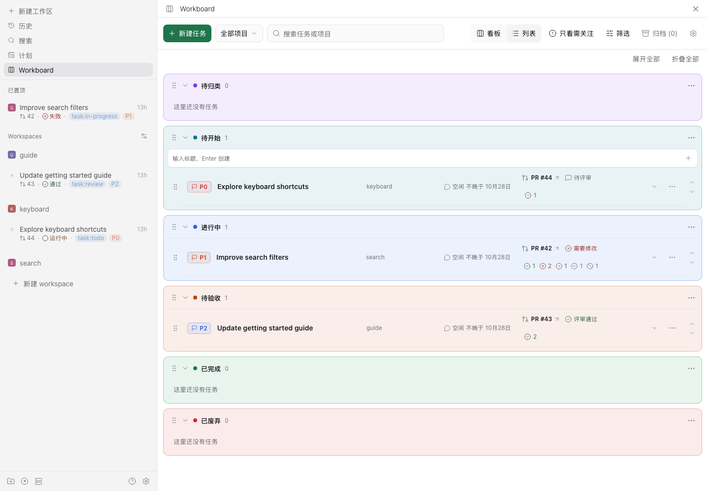
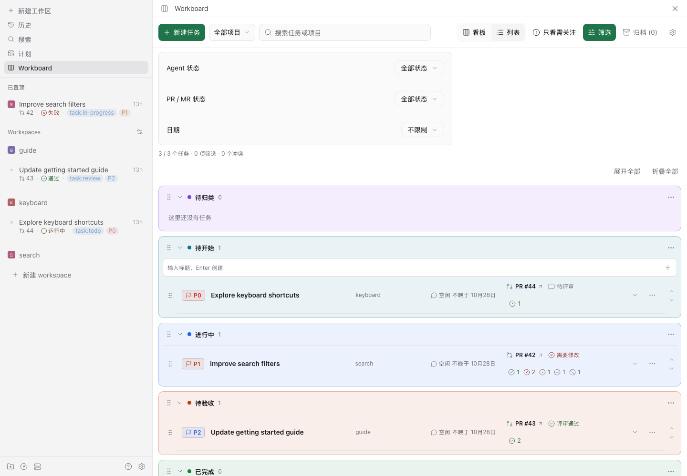
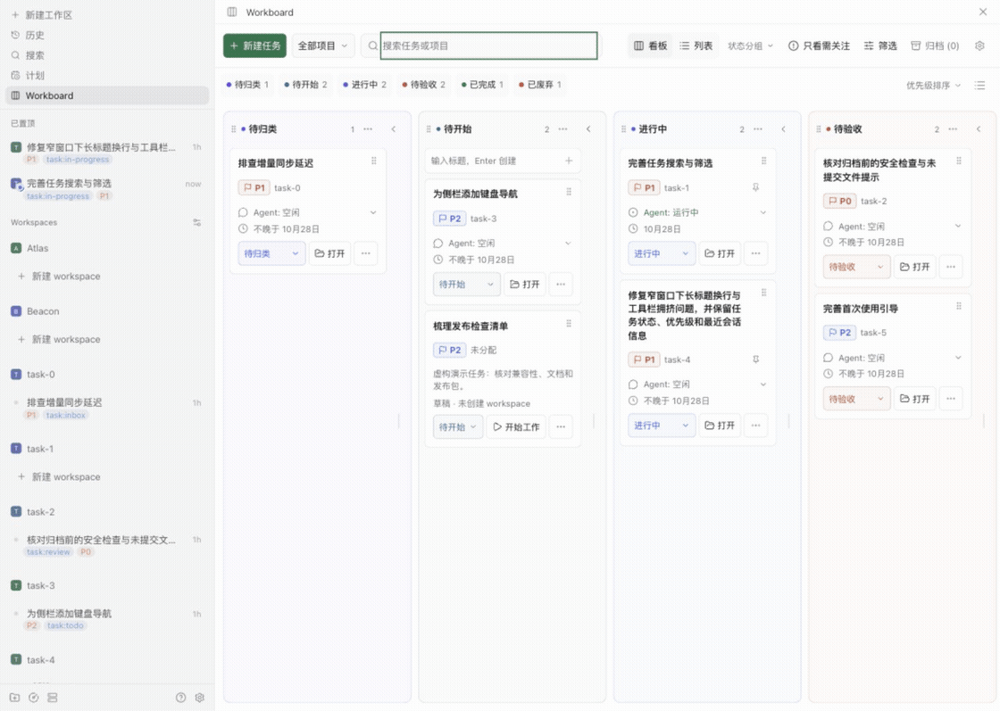

# Paseo Workboard

[English](README.md)

用于管理 [Paseo](https://paseo.sh) workspace 的任务看板，从记录想法到完成工作。

Workboard 将活跃 workspace 汇集到同一个看板，每个 workspace 对应一个任务。可以先把想法记为草稿，开始时再创建或关联 workspace，随后在看板或分组列表中跟踪进展。任务状态由你决定；Agent 结束**不会**自动完成任务。


## 功能

- **统一管理 workspace 与草稿。** 自动导入已有 workspace；草稿只需标题，无需目录、workspace 或 Agent。
- **看板与列表两种视图。** 切换时共享任务、筛选和排序，分别记忆各自的分组折叠状态。
- **任务状态与 workspace 标签同步。** 移动任务或在 Paseo 中修改受管理标签，都会更新同一状态，并保留其它标签。可选的状态标签互斥功能会在能识别新标签时替换先前的受管理标签。
- **集中查看工作动态。** 显示 Agent 活动、对话日期，以及 Paseo 提供的 PR/MR、CI 和评审信息；可按项目、活动、PR/MR 条件、待关注状态及最后对话日期筛选。
- **自定义工作流程。** 配置分组和默认分组，通过拖动或键盘调整任务与分组顺序，还可将进行中的 workspace 置顶到侧边栏。
- **可选的自动归档。** 已完成与已废弃可分别启用并设置等待期限，workspace 在最后一次已验证对话超过对应期限后，经活动与 Git 安全检查再归档。默认关闭。

界面跟随 Paseo 桌面端/Web 的语言与主题，文案和日期支持中文与英语。

## 操作演示

看板和分组列表显示同一批任务，共享筛选条件，并分别记住折叠的分组。



**筛选**面板支持按最后对话日期筛选：今天、最近三个自然日、本周或本月。没有对话日期的任务不会匹配日期范围。




将任务移到另一个分组会更新其受管理状态标签。短暂的撤销时限内，可以在工具栏撤销最近一次移动。



分组默认值、状态标签互斥、侧边栏置顶及可选的自动归档可在**设置**中调整。

已完成与已废弃的独立开关、始终显示的等待期限控件和到期确认流程见[归档指南](docs/zh-CN/user-guide.md#归档-workspace)。

## 安装

需要 Paseo 0.11.0 或更高版本，详见 [paseo-plugin.json](paseo-plugin.json)。插件作为受信任、未沙箱隔离的代码运行在 daemon 中，请先审阅源码再安装。

从仓库默认分支安装到当前选中的 Paseo daemon：

```sh
paseo plugin install github:fxbing/paseo-workboard
```

该命令跟随默认分支，可能包含比最新 [GitHub Release](https://github.com/fxbing/paseo-workboard/releases) 更新的改动。每个 Release 标记一个带升级说明的版本快照；升级前请阅读对应说明。在 Paseo 中启用 Plugins 后，从侧边栏打开 **Workboard**。

## 快速开始

1. **找到已有工作。** 活跃 workspace 会显示为任务。使用默认设置时，没有受管理状态标签的 workspace 进入**待归类**；导入本身不会写入标签。
2. **记录想法。** 创建只有标题的草稿，放入配置的草稿默认组，初始为**待开始**；此时不创建 workspace 或 Agent。
3. **开始工作。** 创建 workspace 或关联已有 workspace，需要时再从原生 workspace 发起会话；Workboard 不会替你发送 prompt。
4. **跟踪进展。** 使用状态菜单或拖动把手移动任务，在**设置**中调整分组、默认分组、侧边栏置顶与自动归档。

[使用指南](docs/zh-CN/user-guide.md)详述了筛选、排序、撤销、草稿恢复与设置。

## 文档

| 指南                                                                  | 内容                       |
| --------------------------------------------------------------------- | -------------------------- |
| [使用指南](docs/zh-CN/user-guide.md)                                  | 任务流程、视图、分组与设置 |
| [架构](docs/zh-CN/architecture.md)                                    | 数据归属、同步与安全检查   |
| [发布指南](docs/zh-CN/releasing.md)                                   | 包验证、打 tag 与 Release  |
| [GitHub Releases](https://github.com/fxbing/paseo-workboard/releases) | 各版本升级说明             |

## 参与贡献

**先提 Issue，再提 PR**；已有覆盖同一改动的 Issue 时，直接参与已有讨论。先说明问题或使用场景与预期结果，每个 PR 聚焦一个改动，并关联对应 Issue。

Issue 与 PR 应包含的内容、本地环境和检查要求见[贡献指南](CONTRIBUTING.zh-CN.md)。AI 编程助手还需遵循 [AGENTS.md](AGENTS.md)；`CLAUDE.md` 软链到同一份规则。

开发需要 Node.js（建议使用与 CI 一致的 22.22.2）、npm 和 Git，无需特定运行时管理器。具体要求见[环境与检查](CONTRIBUTING.zh-CN.md#环境与检查)：

```sh
npm ci
npm run check
npm run format:check
```

宿主级检查与本地插件评估使用[隔离集成环境](tests/integration/README.zh-CN.md)。

## 限制

- 部分标签与 workspace 操作通过 Paseo 内部桥接完成，复用宿主会话并校验响应。manifest 的最低版本不代表兼容所有后续版本，升级前请查看 [GitHub Releases](https://github.com/fxbing/paseo-workboard/releases) 中的升级说明。
- 自动归档可能停止 Agent 与 terminal，并可能移除托管 worktree。缺少对话证据（包括已不在清单中的子 Agent）、provider 子 Agent 清单不完整或状态不安全时会延期。订阅恢复后，须重新枚举子 Agent 才能归档；Workboard 无法恢复原生归档或被移除的 worktree。
- 标签、归档状态和侧边栏置顶可在 Workboard 外变化。宿主未提供全部原子操作，结果不确定时需要人工核实，不会进行破坏性重试。
- 支持目标为 Paseo Web 与 Electron 桌面界面，原生移动端不在支持范围内。在该目标内，列表视图仅在 Chrome 中实际验证过；Electron、长时间边缘自动滚动，以及拖动过程中的 `Escape` 或失焦仍待验证。这些交互均已实现（包括拖动取消），并非缺失。

## 许可证与致谢

[MIT](LICENSE)。

本项目参考了 [Paseo Thread Board](https://github.com/samgbafa/paseo-thread-board) 与 [Paseo Kanban](https://github.com/breathi3552/paseo-kanban)。
