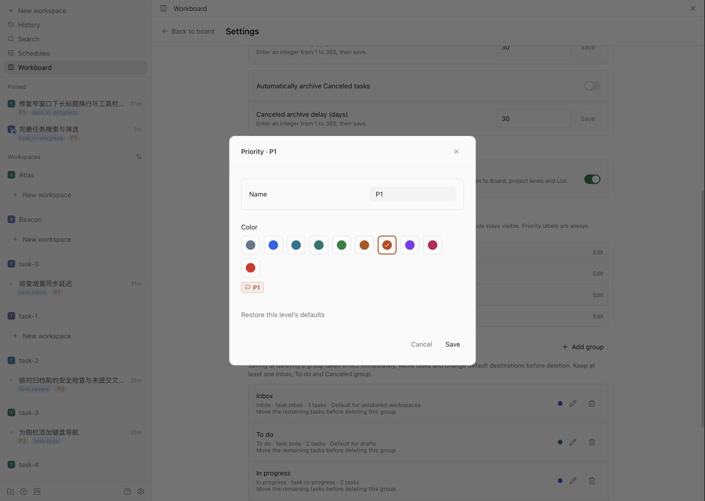

# User guide

[中文](zh-CN/user-guide.md) · [README](../README.md)

## Task model

An active Paseo workspace is one Workboard task. Imported workspaces that do not have a managed status label go to the configured default group, falling back to the first **Inbox** group when no valid default is configured; import itself does not add a label.

A draft is a task without a workspace. Create it with a title to capture work for later. By default, new drafts and workspaces with an explicit `task:todo` label use **To do**. A draft may move to Inbox without binding. Moving it into another work group asks you to create or attach a workspace.

Task status is a business decision. Agent states such as running, waiting for input, or error are shown separately. Ending an Agent session never marks a task done.

## Work with tasks

### Create and start

Create a draft with the new-task form from either view. The status board and List also offer quick-create in To do groups; project grouping uses the new-task form. Quick-create text and errors remain in memory when you switch views or collapse its group; a successful submission clears that group's text, while a failed one preserves it and marks the collapsed group header. A draft has no workspace, conversation, or Agent until you choose **Start work**. Only the initiating control and its submitting form are locked while submitting; other cards and settings remain usable. Duplicate submissions from the same control are blocked. Concurrent stage or settings changes can reject a request with a localized message. A failed confirmation stays open with an explanation for retry after refreshing. Missing directories, workspaces, Git projects or destination groups are listed above Start.

Start work by creating a new workspace or attaching an existing one. A new workspace keeps the draft title and description. An attached workspace keeps its workspace name; the draft title and description are added to its notes, so it remains one task. When that workspace already has a task, each merged draft is recorded separately. Choose **Restore merged draft** on its card to restore the original ID, title and description as an unbound draft in the current default draft group. Its appended text is removed only when it still matches exactly once. Changed or ambiguous text, an occupied original ID, or an archived surviving task blocks restoration and keeps the merge records. Starting work does not create an Agent or send a message. Start work uses the configured In progress group, falling back to the first In progress group when the setting is unset, missing or has an invalid type. Configure an In progress group if none exists. An existing pending binding keeps its original destination, and an explicit destination from a cross-column move takes precedence over this default.

After a binding fails, retry its original intent or choose **Cancel binding** on the card. Executing or queued bindings cannot be canceled. Cancellation clears only the pending plugin intent and keeps any created or linked workspace. A draft without a workspace can start again; a linked task can change groups.

### Edit a task

When creating or editing an unbound draft, select a project or choose **Unassigned** to clear it. For a workspace-bound task, the editor shows only that task's project; it cannot be changed here. If the project is missing from the project list, the editor shows the stored project name, or **Unassigned** when no name is stored.

### Change status

Each group has a managed workspace label. In the default mapping, those labels are:

| Type        | Default label      |
| ----------- | ------------------ |
| Inbox       | `task:inbox`       |
| To do       | `task:todo`        |
| In progress | `task:in-progress` |
| Review      | `task:review`      |
| Done        | `task:done`        |
| Canceled    | `task:canceled`    |

Use the status menu or drag a desktop card by its handle. Moving a bound task updates its managed label; changing that native label also updates the board. Regular labels are retained. If more than one managed status label is present, Workboard reports a conflict and lets you choose one status to resolve it. A successful move between groups highlights the task and shows the most recent move in a toolbar feedback bar for about 8 seconds. **Undo move** remains available there even if the task is filtered out, its group is collapsed, or you switch views; it returns the task to the previous group while retaining ordinary labels. Expiry, a refreshed card change, or a changed/deleted original group type or label removes the entry. Undo verifies the successful move's task timestamp and original group definition at the server; concurrent task, group or native label changes reject it with a message. Conflict resolution has no single previous group to restore and does not offer this undo.

Board dragging starts after 6px, shows a card preview, highlights a target, and autoscrolls near the horizontal edge. Press `Esc`, leave the window, or release outside the board to cancel. Each group initially uses last activity: bound tasks use the last verified conversation, drafts use their last edit, and workspaces with no conversation stay last. Drag within a desktop column to save an order, using the vertical insertion line; the list scrolls near its top or bottom edge. Narrow layouts offer up/down controls and Alt+Up/Down. With filters, the chosen visible neighbor is an anchor: only the selected task moves, while other tasks keep their relative order. A pending reorder locks that column's ordering controls. Concurrent membership/order changes reject the request, clear its preview, and refresh the board. New cards appear at the tail in activity order. A card returning to a column keeps its saved position until another manual reorder compacts that column's current IDs. Use **Restore activity order** in the group menu to reset. Saved order is shared across clients and survives reload. Ordering does not edit task timestamps, labels, pinning, conversation evidence or archive gates; cross-column moves continue to use the status mutation and undo.

For external label changes, **Exclusive status labels** in Settings is on by default and can be turned off. An explicitly saved setting is preserved. When upgrading data without this setting, Workboard checks current workspace labels once: any managed status-label conflict keeps the switch off; otherwise it turns on. The decision is saved. Until the complete workspace list can be read and the decision saved, automatic status-label resolution stays off. When Paseo adds one new managed status label alongside the task's previously known label, Workboard can identify the new choice and remove the old managed label. Other labels remain. If the previous status is unknown or several additions make the latest choice ambiguous, Workboard keeps the conflict for manual resolution.

## Use the board and list

On desktop and Web, Workboard follows Paseo's language setting. Chinese and English are supported; other Paseo languages fall back to English. When Paseo follows the system language, Workboard follows the same locale selection. There is no separate plugin language setting. Built-in group names and dates change with the UI; custom group names, task titles and notes stay as entered.

### Read tasks

Cards and list rows show task title, project, activity, and the latest conversation date. Hovering a title underlines it and explains its action: drafts open editing, bound tasks open their workspace. If navigation is unavailable, a message directs you to the Paseo workspace list. A time written as "No earlier than {date}" or "No later than {date}" means Paseo only supports a bound there: the first is the recorded last user message or the oldest rows of a partially replayed window, the second is Paseo's recorded activity. Workboard never shows Paseo's recorded activity as if it were the message time. Expand a card or row for labels, Agents, and a full PR/MR title. Choose an Agent row to open its conversation in the owning workspace on the selected host, without searching again. When the host does not provide Agent navigation, the rows remain readable text.

When Paseo supplies it, both layouts show PR/MR state using native-style icons, with visible CI and review text. The summary stays visible in compact List rows and while details are open. CI counts appear in the order passed, failed, pending, skipped, and cancelled, omitting zero categories, for example **CI 1 passed 2 failed 1 pending**. Skipped and cancelled checks stay separate. Missing or empty check details fall back to the aggregate **CI passed**, **CI failed**, or **CI pending** result; without either source, CI stays hidden. Review text reads **Approved**, **Changes requested**, or **Awaiting review**, and stays hidden when no decision is available. List rows also keep task issues, unavailable PR/MR data, failed CI, requested changes, binding, and overdue archive warnings visible without opening details; row actions open from a separate More actions control. Workboard does not query your forge directly. A merged or closed PR/MR does not change task status.

A bound workspace with no Agents and an unknown conversation time shows "No Agents" in place of the conversation time. Unknown conversation time alone does not make an agentless workspace need attention; other warnings still apply. Archive safety checks are unchanged.

Paseo-delegated subagents are treated as part of their parent Agent. Their waiting, error, unread, and running states do not contribute to workspace activity, activity filters, or the activity reasons for Needs attention. Their original states remain visible in expanded Agent details, and their conversation evidence and running or waiting states still count in archive safety checks. Provider subagents are distinct from delegated Agents and keep their existing behavior.

Current failures of non-delegated Agents and failed provider subagents keep the workspace in Needs attention even while another Agent keeps working. An idle Agent's leftover error can stop determining the task's activity after a later user message to another unarchived, non-delegated Agent without an error. Renaming an Agent or editing its labels does not count as recovery. The original error remains visible in the expanded Agent details.

Cards reserve space for the drag handle only in desktop columns. Actions wrap within narrow cards, use a two-pixel gap, and highlight on hover or keyboard focus. Warning text uses the same size as card metadata.

Needs attention covers waiting, error, and unread activity; label or synchronization conflicts; conversation, archive, Git, terminal, or directory problems that need verification; and an open or draft PR/MR with failed CI or requested changes. Merged, closed, and unavailable PR/MR data never trigger attention from an older CI result. Focus, hover, or tap an explanatory icon for its reason. Touch-opened hints dismiss after about 4 seconds. Hover and focus hints remain until leaving or blurring the control, scrolling, or pressing Escape.

### Filter and adjust the view

Switch between **Board** and **List** in the toolbar. Both layouts share task data, group order, saved default task order, and filters; each remembers its own collapsed groups on this client and host. Priority sorting is enabled by default for both views. Equal-priority tasks retain the saved default order. Turn it off in Settings to reorder tasks manually. Filter by project, text, attention, Agent activity, or PR/MR condition. Filters apply immediately and are saved to the current client and Paseo host after about 300ms without changes; leaving flushes the latest unsaved values. The search clear button clears only text; Clear filters still resets all conditions. Conflicts follow the current filters and have a separate count, outside the column-task N/M totals. Selected filters use the theme accent, and project and stage choices both use Check icons. Empty filtered results can clear the active filters or create a task. A runtime disconnect offers a refresh button to retry.

The List view scrolls vertically through every group, including empty groups. Each group shows matched/total task counts while filtering. Expand or collapse one group, or use Expand all and Collapse all. A collapsed group with matches offers an expand hint; searching does not rewrite its saved collapsed state. With priority sorting off, drag a task within a group to an insertion line, or onto another group header or body to move it there. Empty and collapsed groups accept drops without expanding automatically. Drag group handles to reorder groups. The list autoscrolls near its vertical edges; Escape, window blur, a view switch, or a filter change cancels an unfinished drag. Use menu up/down actions or Alt+Up/Down on focused handles when dragging is inconvenient. Disconnected clients can still switch views, filter, and fold groups, but cannot mutate task data.

In the desktop Board, groups can be reordered, resized, collapsed, colored, and located. Pressing a column title opens group options. Drag its title to reorder, or use Alt/Meta+Left/Right Arrow; plain arrows do not commit a reorder. Group reordering has no undo entry yet; move it back manually. Resize handles have a separate 36px drag area with an accent indicator on hover or focus; arrows change width, and Home or double-click resets it. Column width and collapsed state are local client preferences scoped to the current host. Project lanes save these independently per project, separately from the status board. Collapsing only changes the display. A successful card drop into a collapsed group expands it again.

In the Board, the locate-groups button opens a group list. Selecting a desktop group expands it and scrolls to its column; on a narrow layout it selects that group. Only the Board view uses one group at a time on narrow layouts; the List view keeps all groups visible as compact rows. Active filters show a rounded count badge, distinct from the Archive count. In the narrow Board, arrow keys move between groups, and `Home` and `End` jump to the first or last group.

The **Date** filter uses the displayed last conversation time. **Today** starts at local midnight; **Last 3 days** includes today and the two previous calendar days; **This week** starts Monday; **This month** starts on the first. Tasks without a conversation date do not match a date range. Date ranges filter the displayed task list; they do not alter archive eligibility.

The grouped list below uses fictional tasks.

## Configure groups

Groups have a name, type, managed label, and display color. Color is purely visual: it does not change labels, task rules, pinning, or archival. Workboard uses the same group color in column headers, card accents, status choices, narrow tabs, and group settings. All ten group colors have independent light and dark palettes. The default color family follows the native stage label color; custom colors remain visual only. Workboard reads the theme surface RGB channels from 3/6/8-digit hex or rgb/rgba (alpha does not select a backing surface). Unrecognized formats use each color's fixed light fallback. New groups recommend an unused color first, then the least-used color.

Keep at least one Inbox, To do and Canceled group. Settings let you select a default To do group for new drafts and a nonterminal default group (Inbox, To do, In progress or Review) for unlabeled workspaces. Done and Canceled cannot be selected, and changing a selected default to a terminal type requires choosing a different default first. Stored terminal defaults safely fall back to Inbox. Unset or deleted destinations fall back to the first To do or Inbox group, respectively. A separate **Default Start work group** setting selects only In progress groups; it does not change unlabeled workspace imports. Before deleting its selected group or changing its type, change this default first. Existing invalid start-work settings remain readable and safely fall back, while saving an invalid selection is refused. Explicit labels still follow their mapping. Deletion reports remaining tasks separately from default destination use: move tasks or change the corresponding default group first. Group edits apply when the dialog saves; general switches and default selections save immediately.

Workboard settings opened inside Paseo's settings panel omit the Back to board entry; settings opened from the board retain it.

Reordering groups changes only their display order. It does not change the default draft destination or which In progress group Start work chooses.

## Archive workspaces

Automatic archive is off by default. Open **Settings → Automatic archive**:

1. **Set waiting periods.** Each rule always shows its 1–365 day input (30 by default) and **Save** to the right. You can save a period while its rule is off; this does not enable archive.
2. **Choose a rule.** Enable Done and/or Canceled with their independent switches. Both are off by default; enabling one does not enable the other. Toggling uses the saved period, never unsaved input.
3. **Review due tasks.** Enabling a rule or shortening an enabled rule's period asks for confirmation if the change makes tasks due. Inspect the full candidate list with titles, status, conversation evidence, and proposed deadlines. Longer lists scroll. Confirm to save the complete proposed settings; cancel leaves the saved rules unchanged.

Turning a rule off pauses it while keeping its waiting-period controls visible and editable. Its saved period and draft input remain on this settings page. Turn both off to stop automatic archive. Disabling a rule, lengthening a period, or making a change that creates no newly due tasks saves without confirmation. A task's obsolete archive warning and retry delay clear when its rule is disabled or its proven conversation time is no longer due; independent warnings remain.

The candidate list uses the proposed settings and refreshes with board evidence, showing an empty state when nothing remains due. Concurrent settings changes invalidate confirmation; review a fresh proposal before saving.

Upgrading from the former master switch retains each rule's effective state: if the master was off, both rules stay off; if it was on, each rule keeps its enabled state. All waiting periods are retained.

A task becomes due only when its rule is enabled and its last verified user or assistant conversation is strictly older than the period. When the exact time is unavailable, a proven upper bound from Paseo's recorded activity can be used and is labeled as a conservative upper bound. Label changes, task edits, tool calls, import times, and displayed `≥` bounds are not archive evidence.

When a workspace has zero Agents, the first trustworthy empty observation starts a conservative waiting period. Its displayed `≤` time is an upper bound, not the exact last conversation time. Further empty observations, task edits and label changes keep that time. An Agent appearing or an Agent/provider lifecycle event resets it, including creation and deletion between refreshes. Restart, disconnect, subscription failure or resnapshot, or an inventory read failure also restart the period from the next trustworthy empty observation. Already recorded children or unresolved child enumeration still postpone archive after the last Agent is deleted.

Workboard does not read an idle Agent's history on each refresh, because Paseo would resume that Agent's provider process. An idle Agent's card shows a `≥` or `≤` bound with a note that its provider children were not listed because the Agent is idle. When such a task's recorded time is older than the period, Workboard checks it once before archiving: it lists the sub-agents and reads the idle Agent and each sub-agent. That check can load the idle Agent, and the Agent stays loaded if the task is then not archived. A failed check delays the archive and is retried with a growing wait; a recent conversation it finds postpones the next check. The confirmation shown before a rule is enabled or shortened also lists such idle tasks whose recorded time is already older than the period, because the check may archive them right afterwards. These entries say that the recorded activity is due for a recheck and that the last conversation time has not been verified; they do not show it as a conversation bound.

Older settings use the former shared period for each rule until its period is edited. If an upgrade adds a missing Canceled group, automatic archive pauses because the new label may match existing workspaces; Settings explains why until you re-enable it. Other upgrades retain your archive preference.

Before archiving, Workboard defers when provider children cannot be enumerated, no conversation bound can be proven, or the workspace has active/waiting Agents, terminals, running scripts, or unsafe or unverified Git state. An enumerated child also postpones archiving when its history lacks a provable upper bound; a verified empty timeline does not. An incomplete child inventory keeps archive eligibility unknown while retaining the displayed conversation time; an old parent timestamp does not prove that its children are inactive. A previously observed child disappearing from the list also blocks archive. Its last read, even an exact time, upper bound or empty history, cannot prove that no message arrived before removal. The displayed time is retained across refreshes and restarts. After subscription recovery or failure, Workboard rechecks the child inventory before allowing archive, keeping already observed children if that check fails. A failed enumeration for an active (running or waiting) parent is retried after a fixed one minute. An idle parent is not enumerated during a refresh at all; only the archive recheck lists it, and a failed recheck backs off 1, 2, 4… minutes up to one hour. It never stashes, commits, pushes, or deletes files itself.

An automatic archive uses Paseo's native workspace archive. That can stop Agents and terminals and may remove a managed worktree. Success requires a native response with `error=null` and `archivedAt`, followed by a refresh in which the workspace leaves the native active list. Uncertain outcomes remain visible for manual review and are not blindly retried.

Operation IDs are shown only for uncertain or external archive records. On the **Archive** page, choose **Confirm archived** for an uncertain or external archive to keep its record, or **Restore to board** to clear the record and return the task to its original group. Restoration does not recover a native workspace or directory. If the workspace is absent from the host active list, the task stays visible with a request to verify its native state. Stale requests are rejected; refresh before resolving them. If the original group was deleted, restoration is refused and the archive record is kept until its group configuration is restored.

Deferred automatic checks back off exponentially from one minute to a maximum of one hour. Relevant state changes, including native worktree ownership becoming available, or a different blocking reason found during a check reset the delay. Restart clears the backoff; archive safety requirements remain unchanged.

An unbound draft in a Canceled group can be manually archived from the board. It has no native workspace and does not wait for the automatic archive delay. Choose **Restore to board** in Archive to keep its title and description and return it to the original group. A deleted group or a type that no longer accepts drafts blocks restoration and keeps the record. This does not restore a worktree.

Paseo's native **Archive merged PR workspaces** setting is separate. It follows its own merge observations and safety checks, does not use Workboard’s waiting period, and does not set a Workboard task to Done.

## Pin In progress workspaces

The sidebar-pin setting is enabled by default. It follows the group's **In progress** type, not Agent runtime state. Workboard adds a sidebar pin when a task enters an In progress group and removes only a pin that it can identify as its own when the task leaves.

Manual pins are preserved. If you manually remove an automatic pin while the task remains In progress, Workboard does not force it back during that stay; leaving and re-entering the group can apply it again. Disabling the setting removes Workboard-owned pins and retains manual pins.

The native pin API has no ownership or compare-and-set operation. When an operation is uncertain because of a crash or concurrent native change, Workboard keeps the pin rather than risk removing a manual one.

When stored data has an unsupported version or cannot be parsed, the board shows the reason and stops automatic retries without resetting data. Contact a maintainer to repair it. Transient connection failures still retry automatically.

## Limits and support boundaries

- The plugin manifest sets the minimum Paseo version. Its internal label bridge may require changes later; see the README installation and limitations notes for the compatibility range.
- Local filters, view choice, separate board/list collapsed groups, and board column widths are stored per client and host; they are not shared task data.
- Workspace labels and native archive/pin operations can change outside Workboard. The plugin rechecks state where possible, but native APIs do not provide every atomic operation.
- Paseo refuses the provider-subagent API for archived parents, and its pi provider replays history without per-row timestamps, so Workboard retains displayed bounds and defers automatic archive when child inventory is incomplete or conversation evidence cannot safely bound parent and child history.

## Project grouping and priorities

The toolbar has a **Board / List** segmented control and a grouping dropdown showing **By status** or **By project**. The menu marks the selected choice and closes on selection, outside press or Escape. Sorting is controlled in **Settings → Sorting**.

In **Board** view, choose **Group by project** for one collapsible lane per native project. Each lane keeps the existing status columns and card drag actions. **Group by status** returns to the flat status board. The List view retains its original status layout. Search and filters apply before grouping, and lane headings show matching and total counts for tasks displayed in their status columns. Status-conflict tasks stay in the global conflict area and do not create or count toward project lanes. Creating a task from a project's lane preselects that project.

The priority control and pin indicator sit below the card title. Click the flag to choose **P0**, **P1**, **P2** or **P3**. P0 is highest; unset values display P2. Defaults are red, orange, blue and gray respectively. In **Settings → Priorities**, edit each level’s name (1–24 characters), choose from ten theme-aware colors, preview and save, or reset one level. The Pn code stays visible beside custom names. Appearance settings are saved on the host and apply across clients without changing levels or saved order.

Draft priorities live in Workboard data on the daemon. Bound workspaces sync with native `P0`, `P1`, `P2` and `P3` labels. Importing an unlabeled workspace shows P2 without writing labels. Every explicit selection, including selecting the displayed P2, leaves exactly the selected priority label. Status and unrelated labels remain intact. Legacy `priority:high`, `priority:normal` and `priority:low` labels are read as P1, P2 and P3; explicit selection converts the workspace to the selected Pn label without deleting native label definitions. New status configurations cannot use the new or legacy reserved names. Existing status groups retain ownership of their labels, which priority detection and writes exclude. Rename an occupied target before selecting it or creating a workspace with that priority; unrelated settings can be saved while old groups are repaired individually.

Priority labels are always exclusive, independently of the status-label setting. If one new priority label appears alongside a previously clean observed label, the newcomer wins. Initial or ambiguous conflicts stay visible in **Needs attention** and temporarily display the highest rank until explicitly resolved. An interrupted native write remains uncertain across refresh and restart; refresh to inspect the result, then explicitly choose a priority or retry the pending binding. Workboard does not automatically retry that cleanup. Custom appearance does not rename or recolor native labels. New workspaces inherit the draft priority; attaching an existing workspace keeps its priority, and restoring a merged draft restores its original level.

**Settings → Sorting → Priority first** defaults to on for Board, project lanes and List. Each status group sorts P0 → P3; ties retain the saved default order. Turning it off restores that order. Same-group drag, keyboard and up/down reordering are disabled while priority sorting is on; cross-group moves and group reordering remain available. Changing sorting or a task’s priority cancels active gestures. The sort preference is stored on the current client per host, preserving any explicit disabled choice.

