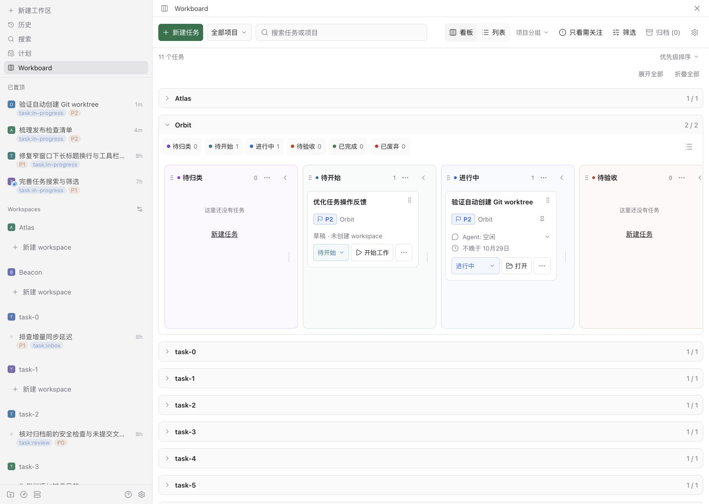
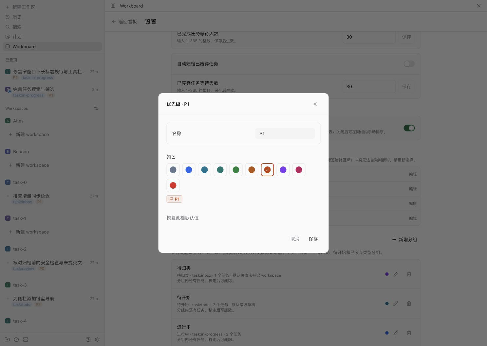

# 使用指南

[English](../user-guide.md) · [README](../../README.zh-CN.md)

## 任务模型

每个活跃的 Paseo workspace 对应一个 Workboard 任务。导入时，没有受管理状态标签的 workspace 会进入设置中指定的默认分组；未配置时回退到首个**待归类**组。导入本身不会补写标签。

草稿是尚未关联 workspace 的任务。只需标题即可记录，以后再继续。默认情况下，新建草稿和显式带有 `task:todo` 标签的 workspace 会进入**待开始**。草稿可以移到待归类而不绑定 workspace；移到其它工作分组时会要求创建或关联 workspace。

任务状态是业务决策。Agent 的运行、等待输入和报错等状态会单独显示。Agent 会话结束不会把任务标记为已完成。

## 使用任务

### 创建与开始

可从任一视图的新建任务表单创建草稿。按状态分组的看板和列表还提供待开始类型分组的快速创建控件；按项目分组时使用新建任务表单。快速创建的文本和错误在切换视图或折叠分组后仍保留在内存中；成功后清空对应分组的文本，失败时保留并在折叠组头显示标记。草稿在选择**开始工作**前没有 workspace、会话或 Agent。提交期间只锁定发起操作的控件及其提交表单，其它卡片和设置仍可使用；同一控件重复提交会被拦截。并发状态或设置变化可能导致请求被拒绝，此时会显示本地化提示；确认弹窗失败时保留并显示失败说明，可刷新后重试。开始按钮上方会列出缺少的目录、workspace、Git 项目或目标分组。

开始工作时可创建新 workspace 或关联已有 workspace。新建 workspace 会保留草稿标题和说明；关联已有 workspace 时保留原 workspace 名称，并将草稿标题和说明合并到备注，因此始终是一张任务卡。若已有该 workspace 的任务，卡片会保留每次合并的草稿来源，可分别选择**还原合并草稿**，恢复原 ID、标题和说明，清除 workspace 关联，并落到当前新草稿默认分组。只有当合并时追加的文本仍唯一匹配时才从备注移除；文本已修改或匹配不唯一、原 ID 被占用、任务已归档时拒绝还原，保留全部合并记录。开始工作不会创建 Agent 或发送消息。开始工作使用配置的进行中组；未配置、分组缺失或类型失效时回退到首个进行中组，没有该类型时请先配置分组。已有待完成的绑定保留原目标；跨列移动给出的显式目标优先于默认值。

绑定失败后，可以继续上次绑定，也可以从卡片选择**取消绑定**。正在执行或排队的绑定不能取消。取消只清除插件的待处理意图，不删除已创建或关联的 workspace；未创建 workspace 的草稿可以重新开始，已关联的任务可以继续修改分组。

### 编辑任务

创建或编辑未绑定 workspace 的草稿时，可以选择项目，也可以选择**未分配**来清空项目。已绑定 workspace 的任务只显示自身项目，不能在此更改。如果项目已不在项目列表中，编辑窗口会显示存储的项目名；没有存储名称时显示**未分配**。

### 改变状态

每个分组都有关联的受管理 workspace 标签。默认映射如下：

| 类型   | 默认标签           |
| ------ | ------------------ |
| 待归类 | `task:inbox`       |
| 待开始 | `task:todo`        |
| 进行中 | `task:in-progress` |
| 待验收 | `task:review`      |
| 已完成 | `task:done`        |
| 已废弃 | `task:canceled`    |

可通过状态菜单或拖动桌面卡片的把手改变状态。移动已绑定任务会更新其受管理标签；修改原生标签也会更新看板。普通标签会保留。若同时存在多个受管理状态标签，Workboard 会提示冲突，可选择一个状态修复。成功跨分组移动后，任务高亮，工具栏下方约 8 秒显示最近一次移动的反馈及**撤销移动**；任务被筛选隐藏、所在组折叠或切换视图后仍可撤销，回到原分组；普通标签仍保留。窗口过期、刷新发现卡片变化或原分组类型/标签改变、分组删除会移除入口。服务端校验成功移动后的任务时间戳与原分组定义；任务、分组或宿主标签在撤销前改变时会拒绝操作并提示。冲突修复没有可恢复的单一原分组，不提供该撤销入口。

看板拖动超过 6px 后开始，显示卡片预览、突出目标列，并在靠近横向边缘时自动滚动。按 `Esc`、窗口失焦或在看板外松手都会取消。每个分组默认按最后活跃时间排序：已绑定任务取最后一次已验证对话，草稿取最后编辑时间，没有对话的 workspace 排在末尾。在桌面列内拖动可保存顺序，纵向插入线显示落点，靠近列表上下边缘时滚动。窄屏提供上下移按钮与 Alt+上/下方向键。筛选时以可见邻居作锚点，只移动选中的任务，其它任务保持相对顺序。排序提交期间锁定该列排序控件；成员或顺序并发变化时拒绝请求、清除预览并刷新。新卡按活动顺序追加到末尾；任务回到原列时恢复保存的位置，下一次手排压实该列当前 ID。在分组菜单选择**恢复活动排序**可重置。顺序跨客户端共享并在重载后保留；排序不改任务时间戳、标签、置顶、对话证据或归档门禁。跨列移动仍使用状态 mutation 与撤销。

外部标签变更由设置中的**状态标签互斥**处理，默认开启，可手动关闭。已明确保存的设置保持不变。升级的数据缺少该设置时，Workboard 会一次性检查当前 workspace 标签：任一 workspace 的受管理状态标签有冲突则保持关闭，否则开启，并保存判断结果。在成功读取完整 workspace 清单并保存判断前，不会自动处理状态标签冲突。当 Paseo 在任务上新增一个受管理状态标签，且先前状态标签仍在时，Workboard 可以识别新选择并移除旧的受管理标签，其它标签不受影响。如果先前状态不明，或同时新增多个状态标签而无法判断最新选择，仍需手动解决冲突。

## 使用看板与列表

桌面与 Web 中，Workboard 跟随 Paseo 的语言设置。支持中文和英语，其它 Paseo 语言回退到英语；Paseo 跟随系统语言时，插件采用相同的语言选择规则。插件没有独立语言设置。默认分组名称与日期随界面切换，自定义分组名、任务标题和说明保持原文。

### 阅读任务

卡片和列表行均显示标题、项目、活动和最近对话日期。标题悬停时显示下划线和用途提示：草稿打开编辑，已绑定任务打开 workspace；当前界面不支持 workspace 跳转时会提示从 Paseo 列表打开。时间写成「不早于 {date}」或「不晚于 {date}」说明 Paseo 那边只能给边界：前者来自 Paseo 记录的最后一条用户消息，或部分回放窗口里较早的行；后者是 Paseo 记录的活动时间。Workboard 不会把 Paseo 记录的活动时间当成消息时间展示。展开卡片或列表行可查看标签、Agent 和完整 PR/MR 标题。

Paseo 提供信息时，两种布局都会用原生风格图标显示 PR/MR 状态，以紧凑的状态图标加数量显示 CI，评审仍显示文字。摘要在紧凑列表行和展开详情时都保持可见。列表将 PR/MR 链接与评审文字组合在第一行，CI 数量以紧凑行距排列在下一行。桌面列表为该列保留至少 240px；Workboard 可用宽度小于 900px 时，任务行切换为紧凑布局。优先级控件与任务标题在垂直方向居中对齐。CI 按成功、失败、进行中、跳过、已取消的顺序显示彩色状态图标及数量，省略零值；悬停或聚焦可查看完整说明，屏幕阅读器也能读取状态名称。跳过和已取消分别统计。检查明细缺失或为空时，回退到单个汇总状态图标，提示中保留完整说明；两种数据都没有时隐藏 CI。评审显示**评审通过**、**需要修改**或**待评审**，缺少评审结论时隐藏。列表行直接显示任务 issue、PR/MR 信息不可用、CI 失败、要求修改、绑定和归档逾期提示；更多操作从独立入口打开。Workboard 不会直接查询 forge。PR/MR 合并或关闭不会改变任务状态。

已绑定 workspace 没有任何 Agent 且对话时间未知时，卡片显示「没有 Agent」代替对话时间。没有 Agent 的 workspace 不会仅因对话时间未知而计入需关注，其它提醒仍然适用。归档安全检查保持不变。

Paseo 委派的子 Agent 视为父 Agent 的一部分。它们的等待、报错、未读和运行状态不参与 workspace 活动聚合、活动筛选或需关注的活动原因。展开 Agent 详情仍可查看其原始状态；它们的对话证据及运行、等待状态仍参与归档安全检查。provider 子 Agent 与委派 Agent 不同，继续遵循原有规则。

即使另一个 Agent 仍在工作，非委派 Agent 的当前失败和失败的 provider 子 Agent 仍会使 workspace 计入需关注。只有另一个未归档、非委派且未报错的 Agent 收到更晚的用户消息后，空闲 Agent 的遗留错误才可能不再决定任务活动状态。重命名 Agent 或修改标签不作为恢复依据。展开 Agent 详情仍可看到原始错误状态。

卡片只在桌面列中为拖动把手预留空间。操作按钮在窄卡片内换行，间隔为 2px，悬停或键盘聚焦时显示底色；告警文本与卡片元信息字号一致。

需关注包括等待、报错和未读活动；标签或同步冲突；需要核实的对话、归档、Git、terminal 或目录问题；以及开放或草稿 PR/MR 的 CI 失败或要求修改。已合并、已关闭和暂不可用的 PR/MR 不会沿用旧 CI 结果触发提醒。聚焦、悬停或点击说明图标可查看原因。触屏打开的说明约 4 秒后自动消失；悬停或聚焦打开的说明保持到离开、失焦、滚动或 Esc。

### 筛选与视图调整

可在工具栏切换**看板**与**列表**。两种布局共用任务数据、分组、保存的默认任务顺序与筛选，并在当前客户端、当前 host 下分别记忆折叠状态。两种视图默认开启优先级排序，同级保留保存的默认顺序；在设置中关闭后可手动调整任务顺序。可按项目、文本、需关注、Agent 活动和 PR/MR 条件筛选。筛选立即生效，并在停止修改约 300ms 后保存到当前客户端和 Paseo host；离开时保存尚未写入的最新条件。搜索框的清除按钮仅清除搜索文本，“清除筛选”仍重置全部条件。冲突列表遵循当前筛选，数量单独显示，不计入列内任务的 N/M。选中筛选使用主题强调色，项目和状态选项统一用勾选图标。筛选无结果时可以清除筛选或新建任务。运行中断连时可点击提示旁的刷新按钮重试。

列表纵向滚动显示全部分组，包括空组。筛选时组头显示匹配数/总数；可逐组折叠、展开，或全部展开、折叠。折叠组有匹配任务时可点击提示展开；搜索不会改写折叠偏好。关闭优先级排序后，组内拖动以插入线排序，拖向其它组的组头或内容区则改变分组；空组和折叠组都能接收任务，完成后不会自动展开。拖动组头把手可调整分组顺序；靠近纵向边缘时自动滚动。按 Esc、窗口失焦、切换视图或筛选变化会取消尚未提交的拖动；也可用菜单上下移动或聚焦把手后按 Alt+上/下方向键排序。断连时仍可切换视图、筛选与折叠，但不能修改任务数据。

桌面看板可调整分组顺序、列宽、折叠状态、颜色和定位。点击列标题打开分组选项；拖动标题调整顺序，键盘需按 Alt/Meta+左/右方向键才会重排，单独方向键不提交。分组重排目前没有撤销入口，可反向调整。列宽手柄使用独立的 36px 拖动区域，悬停或聚焦时显示强调色；方向键调整宽度，Home 或双击恢复默认。列宽及折叠状态是当前客户端、当前 host 的本地偏好；项目分组时每个项目独立保存，与状态看板分开。折叠只影响显示；成功拖入折叠分组的卡片会使该列再次展开。

看板的“定位分组”按钮会打开分组列表。选择桌面分组会展开并滚到该列；窄屏会切换到该分组。窄屏的筛选数量用圆角徽标显示，与归档数量区分。仅看板在窄屏一次显示一个分组，可用方向键切换，`Home` 和 `End` 跳到首尾；列表在窄屏仍显示全部分组的紧凑任务行。

**日期**筛选使用卡片显示的最后对话时间。**今天**从本地时间零点开始；**3 天内**包含今天及之前两个自然日；**本周**从周一开始；**当月**从本月一日开始。没有对话日期的任务不会匹配日期范围。筛选只影响显示的任务，不改变自动归档资格。

下图使用虚构任务展示分组列表。

## 配置分组

分组包含名称、类型、受管理标签和显示颜色。颜色只影响显示，不会修改标签、任务规则、置顶或归档。列头、卡片细色条、状态选项、窄屏页签和分组设置会使用同一颜色。十种分组色各有独立的浅色和深色色板，默认色系对应原生状态标签色；自定义色仍只影响显示。主题表面色支持 3/6/8 位 hex 和 rgb/rgba 的 RGB 通道解析（alpha 不决定背后表面色），无法识别时使用每色独立的固定浅色回退。新分组优先推荐未使用的颜色，之后推荐使用次数最少的颜色。

至少各保留一个待归类、待开始和已废弃类型分组。设置中可选择新草稿的默认分组（待开始类型）及未标记 workspace 的非终态默认分组（待归类、待开始、进行中或待验收）。已完成、已废弃不能设为默认落点；将已选默认组改为终态类型前，必须先选择其它默认组。存量终态默认配置会安全回退到待归类。未配置或指向已删除的分组时，分别回退到首个待开始、待归类组。独立的**开始工作默认分组**只选进行中类型，不改变未标记 workspace 导入；删除已选组或修改其类型前，需先更换该默认值。无效存量配置仍可读取并安全回退，显式保存无效选择会被拒绝。显式标签仍按映射决定分组。删除分组时，组内有任务会提示先移走任务；默认落点占用会提示先更改默认分组。分组弹窗保存后立即生效；通用设置开关和默认分组选择会立即保存。

从 Paseo 设置面板打开 Workboard 设置时，不显示“返回看板”；从看板进入设置时保留返回入口。

调整分组顺序只改变显示位置，不会改变草稿默认去向，也不会改变开始工作时选择哪个进行中分组。

## 归档 workspace

自动归档默认关闭。在**设置 → 自动归档**中：

1. **设置等待期限。** 每条规则始终显示 1–365 天的输入框（默认 30 天）及右侧**保存**。关闭规则时也可保存期限，不会因此开启归档。
2. **选择规则。** 已完成和已废弃各有独立开关，默认都关闭；启用其中一条不会开启另一条。切换规则使用已保存期限，不会应用尚未保存的输入。
3. **核对到期任务。** 开启规则或缩短已启用规则的期限使任务到期时，先核对候选列表中的标题、状态、对话证据及新到期时间。长列表可滚动查看。确认后保存完整拟修改设置；取消则保留原规则。

关闭规则会暂停它，期限控件仍显示且可编辑；当前设置页保留已保存期限与输入草稿。两个都关闭即停止自动归档。关闭规则、延长期限或不新增到期任务的变更无需确认即可保存。规则关闭，或已证明的对话时间不再到期时，会清除该任务过时的归档警告和重试等待；独立警告仍保留。

候选列表按新设置计算，随看板证据更新；已无任务到期时显示空状态。期间若设置被其它操作修改，确认会失效，需要重新预览再保存。

从旧总开关版本升级时，保留各规则的实际启用状态：旧总开关关闭则两条规则都保持关闭；旧总开关开启则各自保留原启用状态。全部等待期限均保留。

任务只有在对应规则启用，且最后一条已验证用户或助手对话严格超过期限时才会到期。精确时间不可得时，可使用已证明的 Paseo 活动时间上界，并明确标注为保守上界。改标签、编辑任务、工具调用、导入时间和显示的 `≥` 下界均不作为归档证据。

workspace 为零 Agent 时，首次可信空观测开始保守的等待期限。卡片显示的 `≤` 时间是上界，并非精确的最后对话时间。后续空观测、编辑任务和修改标签均保留该时间。出现 Agent 或发生 Agent/provider 生命周期事件会重计时，包括两次刷新之间的创建再删除。重启、断连、订阅失败或重新快照、inventory 读取失败也会使等待期限从下一次可信空观测重新开始。已有子 Agent 记录或尚未解决的子 Agent 枚举风险，在删除最后一个 Agent 后仍会推迟归档。

Workboard 不会在每次刷新时读取空闲 Agent 的历史，因为 Paseo 会为此重新启动该 Agent 的 provider 进程。空闲 Agent 的卡片显示 `≥` 或 `≤` 边界，并说明因为 Agent 空闲而没有列出其 provider 子 Agent。这类任务的记录时间超过期限后，Workboard 会在归档前检查一次：列出子 Agent，并读取空闲 Agent 及每个子 Agent。这次检查可能加载空闲 Agent，任务没有被归档时它们会保持加载。检查失败会推迟归档并以递增间隔重试；检查发现近期对话则推迟下一次检查。启用或缩短规则前的确认也会列出这类记录时间已超过期限的空闲任务，因为随后的检查可能立即归档它们。这些条目写明“记录的活动时间已到复核时间、最后一次对话时间尚未验证”，不会把它显示为对话上界。

旧设置继续用原共享期限，直到各条规则分别修改期限。升级时若补建缺失的已废弃组，会暂停自动归档，因为新标签可能匹配已有 workspace；设置页会持续说明原因，直到重新开启。其它升级保留原归档偏好。

归档前，如果无法枚举 provider 子 Agent、无法证明任何对话上界，或 workspace 有运行/等待的 Agent、terminal、运行脚本，或 Git 状态不安全/无法核实，Workboard 会延期。已枚举子 Agent 的历史若无法证明上界，同样延期归档；已确认空历史除外。子 Agent 清单不完整时，归档资格保持未知，卡片仍保留对话显示时间；父 Agent 的旧时间不能证明子 Agent 没有新活动。已观察的子 Agent 从清单消失后，同样阻止自动归档。上次读取即使得到了精确时间、上界或空历史，也不能证明移除前没有新消息；刷新和重启后仍保留原显示时间。订阅恢复或失败后，Workboard 重新检查子 Agent 清单，再判断能否归档；检查失败时保留已观察的子 Agent。活跃（running 或 waiting）父 Agent 的子 Agent 枚举失败后，固定一分钟后重试。空闲父 Agent 在刷新里根本不枚举，只有归档复核才会列举它，复核失败按 1、2、4…分钟指数退避，最长一小时。它不会自动 stash、commit、push 或删除文件。

自动归档调用 Paseo 原生 workspace 归档。这可能停止 Agent 与 terminal，并可能移除托管 worktree。成功需要原生响应 `error=null` 且存在 `archivedAt`，随后刷新确认 workspace 已从原生活跃列表消失；不确定结果会保留供人工处理，不会盲目重试。

操作 ID 只在归档结果待核实或外部归档记录中显示。在**归档记录**页，对结果未知或外部归档记录，可以选择**确认已归档**保留记录，或选择**放回看板**清除记录、回到原分组。放回看板不会恢复原生 workspace 或目录；workspace 不在宿主活跃清单中时，任务会保留并提示核实原生状态。过时的请求会被拒绝，请刷新后再处理。原分组已删除时，放回操作会被拒绝并保留归档记录，请先恢复分组配置。

延期的自动归档检查从 1 分钟开始指数退避，最长 1 小时；相关状态（包括原生 worktree 所有权信息就绪）或检查发现的阻塞原因变化后重新检查。重启会清除退避，归档安全条件保持不变。

未绑定且位于已废弃分组的草稿可以从看板手动归档。它没有原生 workspace，不需要等待自动归档期限。归档页可选择**放回看板**，保留标题和说明、回到原分组；原分组已删除或类型不再支持草稿时拒绝恢复并保留记录。此操作不恢复 worktree。

Paseo 原生的 **Archive merged PR workspaces** 设置是独立功能。它按自己的合并观察和安全检查工作，不使用 Workboard 的等待天数，也不会把 Workboard 任务改为已完成。

## 置顶进行中 workspace

侧边栏置顶默认开启，按分组的**进行中**类型判断，而不按 Agent 是否运行。任务进入进行中分组时 Workboard 会添加侧边栏置顶；离开时只会取消它能识别为自己创建的置顶。

手动置顶会保留。如果在任务仍处于进行中时手动取消自动置顶，Workboard 在这次停留期间不会强行恢复；离开再进入后可以重新置顶。关闭开关会移除 Workboard 创建的置顶，保留手动置顶。

原生置顶 API 不提供 owner 或比较并交换能力。崩溃或并发原生变化导致结果不确定时，Workboard 会保留置顶，避免误删手动置顶。

已保存的数据版本不受支持或数据无法解析时，看板会显示原因并停止自动重试，数据不会被重置。请联系维护者处理；连接等瞬时错误仍会自动重试。

## 限制与支持边界

- 插件 manifest 设置 Paseo 最低版本。内部标签桥接在后续版本中可能需要调整；宿主兼容范围与剩余边界见 README 的安装说明和限制说明。
- 本地筛选、视图选择、分别保存的看板/列表折叠状态及看板列宽按客户端与 host 保存，不是共享任务数据。
- workspace 标签以及原生归档/置顶可以在 Workboard 外变化。插件会尽可能重读状态，但原生 API 不提供所有原子操作。
- Paseo 对已归档 parent 拒绝 provider 子 agent API，其 pi provider 回放历史时不给每行时间戳；Workboard 保留展示用边界，在子 Agent 清单不完整，或对话证据无法安全界定父、子 Agent 历史的上界时延期归档。

## 项目分组与优先级

顶部保留**看板／列表**分段按钮和显示当前**状态分组／项目分组**的分组下拉。菜单用勾标记当前选择，选择后关闭，也可点击外部或按 Escape 关闭。排序入口位于**设置 → 排序方式**。

在**看板**视图选择**按项目分组**，每个原生项目成为可折叠的一行，项目内保留原有状态列和卡片拖拽；选择**按状态分组**恢复平铺的状态看板。列表保持原有的状态分组布局。搜索和筛选先作用于任务，项目标题只统计该项目状态列内任务的匹配数与总数。状态冲突任务保留在全局冲突区域，不创建项目行，也不计入项目行数量。从项目分组内新建任务会自动选择该项目。

优先级控件和置顶标记位于卡片标题下方。点击旗标选择 **P0、P1、P2、P3**。P0 最高，缺失值按 P2 显示；默认颜色依次为红、橙、蓝、灰。在**设置 → 优先级**中可修改每档名称（1–24 个字符），从十种适配明暗主题的颜色中选择，预览后保存，也可恢复单档默认值。自定义名称旁始终显示 Pn 编号。外观配置保存在当前主机，同步应用到各端，不改变任务等级和已保存顺序。

草稿优先级保存在 daemon 的 Workboard 数据中。已关联 workspace 与原生 `P0`、`P1`、`P2`、`P3` 标签双向同步。导入无标签 workspace 时只按 P2 显示，不写标签；每次显式选择，包括再次选择显示中的 P2，都会只保留目标优先级标签。状态及其它标签保持不变。旧 `priority:high`、`priority:normal`、`priority:low` 标签分别按 P1、P2、P3 读取，显式选择时才将 workspace 转为所选 Pn 标签，不删除原生标签定义。新建或修改状态标签不能占用新旧保留名称；已有状态分组仍拥有其标签，优先级识别和写入均排除这些名称。选择被占用的目标或用该优先级创建 workspace 前，须先改名对应状态标签；可保存其它设置并逐个修复旧分组。

优先级标签始终互斥，与状态标签互斥开关独立。相对上次干净观察仅新增一个优先级标签时，新标签胜出；首次或无法判断的冲突保留提示并纳入“需要关注”，暂按最高等级显示，等待显式选择。原生写入中断后，未知结果在刷新和重启后仍保留；请刷新核对后重新选择优先级或重试待完成绑定，Workboard 不自动重试清理。自定义外观不改原生标签名或颜色。新建 workspace 继承草稿优先级；关联已有 workspace 保留其优先级，恢复合并草稿时还原原等级。

**设置 → 排序方式 → 优先级排序**默认开启，适用于看板、项目泳道和列表：各状态组按 P0 → P3 排序，同级保留已保存的默认顺序；关闭后恢复该顺序。开启时禁用组内拖拽、键盘和上下移动排序，跨组移动与分组重排保持可用。排序开关或任务优先级变化会取消正在进行的手势。此偏好按当前客户端和 host 保存，并保留之前显式关闭的选择。

